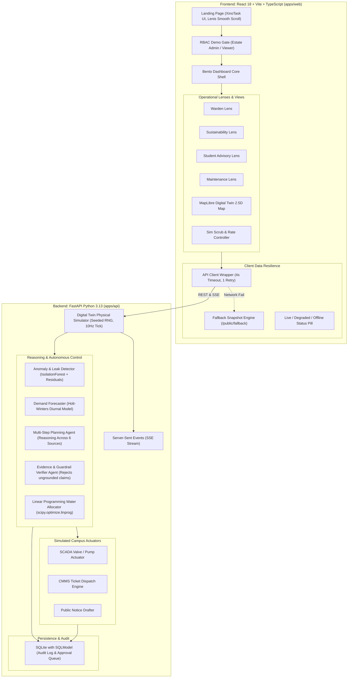
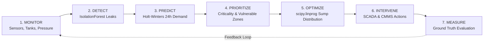
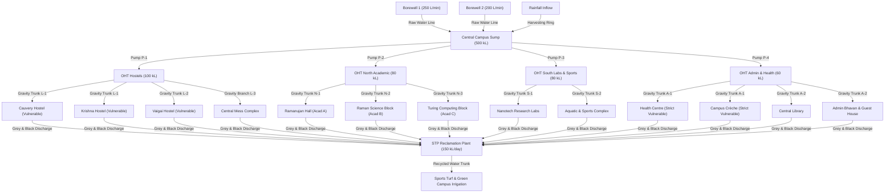

# NEERARAN (நீர்Aran) — System Architecture & Data Engineering

This document outlines the software engineering architecture, agent pipelines, simulation loops, and data resilience protocols powering NEERARAN.

---

## 1. High-Level System Architecture

---

## 2. Seven-Stage Operational Loop

---

## 3. Synthetic Campus Digital Twin Network Topology

---

## 4. Reliability & Fail-Safe Architecture (Zero Blanks Guarantee)

To meet the strict hackathon uptime and demonstration standard:
1. **Network Wrapper**: The web client uses a unified HTTP wrapper (`/apps/web/src/api/client.ts`) with:
   - 4000ms hard timeout per request.
   - 1 exponential retry attempt.
   - Deterministic transparent fallback to `/public/fallback/snapshot_initial.json`.
2. **State Pill Indication**:
   - `Live` (Active 200 responses and live SSE stream).
   - `Degraded` (Serving offline simulation snapshot cached in public bundle).
   - `Offline` (Network partitioned, read-only cache active).
3. **Seeded Determinism**:
   - Simulator PRNG is initialized with seed `42`.
   - All random walk consumption perturbations and anomaly injections produce identical, reproducible states across judge walkthroughs.

