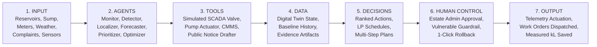
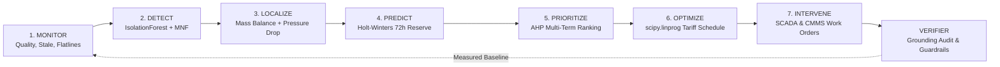
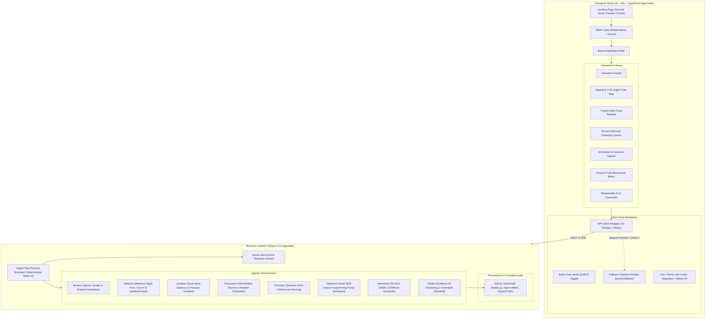
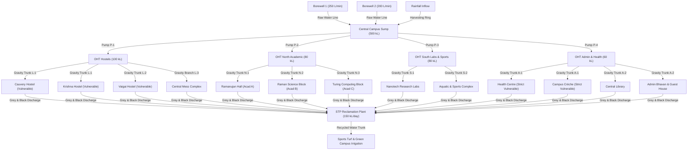

# NEERARAN (நீர்Aran) — System Architecture & Data Engineering

This document details the software engineering architecture, agent pipelines, simulation loops, fail-safe protocols, and known operational limits of NEERARAN.

---

## 1. End-to-End Processing Architecture

The system operates across a strict 7-stage pipeline:

---

## 2. Seven-Stage Agent Operational Loop

---

## 3. High-Level Subsystem Layout

---

## 4. Synthetic Campus Digital Twin Network Topology

---

## 5. Known Operational Limitations

To maintain scientific integrity and transparent engineering standards, NEERARAN explicitly documents the boundary conditions of its digital twin:

1. **Sub-Threshold Pinhole Weepage (< 5.0 L/min)**:
   - Flow perturbations smaller than 5.0 L/min are masked by normal background sensor variance in 5-minute meter sampling intervals.
   - *Mitigation*: These require acoustic pipe listening rods or correlation leak sensors during physical surveys.
2. **High-Frequency Hydraulic Transients (< 2.0 Seconds)**:
   - Sudden water-hammer pressure spikes lasting milliseconds (e.g., rapid solenoid valve closures) fall outside the 5-minute macroscopic digital twin interval.
   - *Mitigation*: Physical surge relief vessels and check valves protect field equipment.
3. **Severe Sensor Cluster Dropouts (> 60% Blackout)**:
   - If over 60% of telemetry meters in a single zone simultaneously lose telemetry or fail, localized hydraulic gradient precision drops to zone-level mass conservation.
   - *Mitigation*: System generates immediate `DATA_QUALITY_ISSUE` alerts and flags localized segment rankings as provisional.
4. **Autonomous Water Quality Remediation**:
   - The platform accurately identifies quality anomalies from turbidity, chlorine, and pH sensors, but does not autonomously actuate chemical dosing without certified lab titration.
   - *Mitigation*: Generates immediate health advisory tickets to the Chief Medical Officer and Estates Office.
